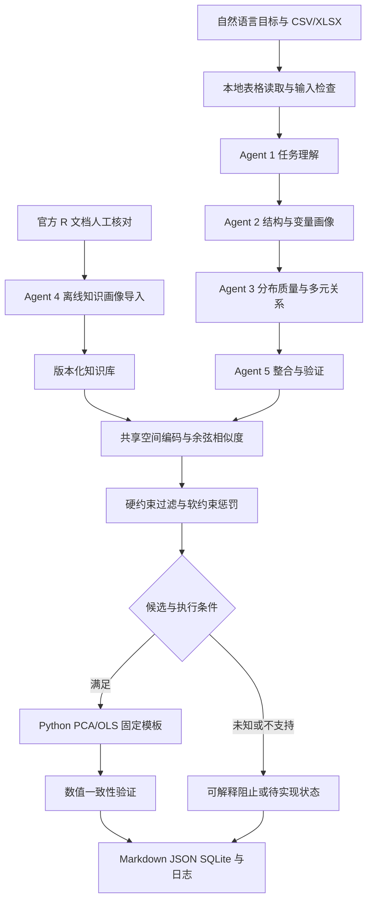

# 架构与接口

版本 0.2.0。设计依据为用户工作手册，优先交付可运行且能追溯来源的基线。已增加可选 DeepSeek 任务理解与离线知识草稿提取，更多模态仍待实现。

系统同时负责查询侧和被检索候选库侧的画像建设。候选库不是外部预置前提：官方资料采集、方法适用数据条件画像、证据校验、入库、版本和索引维护均属于项目范围。现有实现与后续建设的区别见 [KNOWLEDGE_BASE](KNOWLEDGE_BASE.md)。

实现更新至 0.1.1，结构仍遵循首轮设计。差异：输入采用单次字节快照；完整行统计区分解释变量子集和分析所选全部变量；SVD 结果用于复算秩；缺失模式采用打包掩码计数及 JSON 数组键；编码器按完整、有序候选文本缓存一个知识库；查询摘要仅引用所选变量。输出格式迁移见 [BASELINE_REVIEW](BASELINE_REVIEW.md)。

总控是 `pipeline.build_graph` / `run_pipeline`，使用 LangGraph 的共享 `AgentState`。v0.1 为固定顺序；条件处理在检索/执行节点中产生显式状态，尚无重试、并行分支或断点恢复。SQLite 保存最终快照及失败记录，不是 LangGraph checkpoint。

## 五个画像组件

| 组件 | 输入 | 输出 | 调用条件与边界 |
|---|---|---|---|
| TaskUnderstandingAgent / DeepSeekTaskAgent | 目标文本、列名、显式任务及变量角色 | TaskProfile | 默认规则；可选结构化 LLM 输出，验证字段、方法与角色；不发送数据单元格 |
| StructureAgent | DataFrame、来源 | VariableProfile 列表 | 表格读取成功后；数值计算只使用有限观测，缺失和无穷值分别计数 |
| RelationsAgent | DataFrame、TaskProfile | RelationsProfile | 角色校验后；仅计算所选数值解释变量；记录完整行数，完整行不足则不推断矩阵性质 |
| KnowledgeAgent / extract_draft | 五条种子或九条扩展库；独立的官方文档摘录入口 | KnowledgeProfile 列表或未核验草稿 | 导入库校验 Schema/ID；LLM 抽取草稿不自动进入推荐库 |
| ProfileValidationAgent | 数据、来源、任务、变量与关系画像 | DataProfile | 检查角色冲突、变量数和 Schema，整合质量与七层画像；没有实现人工复核 UI |

Agent 3 的分布统计由共享 `profiling` 工具计算，Agent 5 调用工具补齐质量层。职责按输入输出隔离，避免重复计算。LLM 只返回带 `llm_inference/unverified` 证据的语义字段，不覆盖程序统计事实。额外用户限制保留在 TaskProfile.constraints，当前模板不能解释时阻止执行；requested_method 防止显式方法被其他候选替换。

## 三类 Schema 与七层画像

权威实现：`src/stat_agent/schemas.py`；生成文件：`schemas/TaskProfile.json`、`DataProfile.json`、`KnowledgeProfile.json`。

DataProfile 对应来源、结构、变量、质量、多元关系、设计、证据与未知信息七层。证据区分 computed、official_document、user、rule_inference、llm_inference、unknown；verified 表示来源/计算记录已校验，不表示研究假设成立。

均值、样本方差（ddof=1）、分位数、修正偏度、超额峰度等在变量层保存；关系层计算完整有限数值行上的相关、样本协方差、中心化矩阵秩和基于原始协方差能量的 95% 有效维度。其有效维度不等于后续标准化 PCA 的保留维数。奇异矩阵 condition_number 为 null，并用 singular 标识，避免 JSON Infinity。

数值 dtype 不是测量尺度。唯一列只是候选主键。边际偏态不等于模型残差非正态；IQR 异常标记不授权删除。布局、独立性、配对、重复测量、抽样与缺失机制未由输入证实时均标记未知。

## 检索与执行

`Encoder.encode_pair(query, documents)` 返回同空间向量。统一验证形状、有限值和非零范数，执行稳定 L2 归一化。默认 TF-IDF 为离线测试；可选 SentenceEncoder 使用共享预训练模型。

`S = alpha * cosine - penalty_lambda * sum(weight * severity)`。A 仅余弦，B 加硬过滤，C 再加软惩罚；A 仍记录约束，执行阶段不会因消融绕过硬约束。未知条件保留说明，不赋予极大惩罚。没有候选时返回 `no_compatible_method`。

硬约束中明确区分项目基线签名与 R 函数本身能力，例如 v0.1 的数值解释变量要求比 R 公式系统窄。软惩罚只针对观测到的问题；共线性不会自动惩罚 PCA。所有权重与阈值尚未通过独立验证集校准。

固定 Python 模板使用 SVD PCA 和最小二乘 OLS，做重构误差、方差占比及正交条件校验；不执行外部命令。未来执行模型生成代码前必须建立独立的无网络、文件访问受限、资源受限环境；不能把当前进程内模板称为这种隔离环境。

## 持久化与复现

每个 run 使用唯一 ID。日志记录节点成功/失败、耗时、依赖版本、输入 SHA256、知识库 SHA256、配置和 API 使用情况。默认模式 API 调用为零；DeepSeek 路径记录每次运行的真实请求数、缓存/非缓存输入与输出 Token、重试和请求/响应哈希，货币成本为未估算 null。密钥只读 CC Switch，不记录正文或凭据；拒绝凭据请求重定向。失败/限流最多重试一次，整个图仍无 checkpoint 恢复。

固定语义模型配置位于 configs/embedding.json，记录 revision、前缀和维度；本地文件清单逐文件核验 SHA256，结果含模型清单。服务端 LLM 仅返回模型别名，记录 immutable_model_version=false，不宣称权重完全可复现。原始数据不自动提交 GitHub；失败也保存 run.json 和 SQLite 快照。
