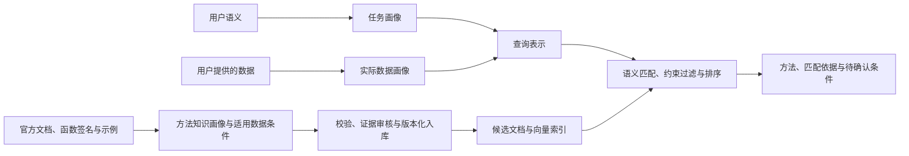

# 被检索知识库的画像建设责任

2026-10-25：根据用户补充，系统负责查询端和候选库端两条画像工作流。被检索的数据库按工作手册定义为 R 函数与统计方法知识库；我们负责其来源收集、画像生成、校验、入库、索引和持续更新，不能将其视为由外部提供的现成库。

## 两端如何匹配

用户数据画像描述实际观测，如样本数、变量类型、缺失率和矩阵秩。候选方法画像描述该方法要求或支持的数据条件，如输入类型、变量角色、样本量与维数关系、分组结构、缺失值处理能力和失败条件。方法本身没有用户数据的均值、方差等观测统计量，二者通过可比较的字段和明确的适用规则关联。

每条候选画像还需保存任务语义、函数签名、关键参数、预期输出、替代方法、官方来源、包版本、证据位置与核验状态。模型假设、实际观测、执行限制和项目偏好必须分别表达。缺乏证据的条件标为未知，不能自动转成硬约束。

例如：任务要求 PCA，用户数据为 20 个样本、100 个数值特征；候选库记录 princomp 原始矩阵接口的 n≥p 条件，因此该接口被排除。prcomp 可以保留为候选，但仍需检查缺失、常数列和缩放要求。规则应能追溯到画像中的依据。

## 当前状态与缺口

| 环节 | 当前实现 | 尚待建设 |
|---|---|---|
| 来源与画像 | CRAN 三包八函数固定版本采集、Rd 静态解析、批量协作画像和恢复 | 扩大方法覆盖、复杂 Rd 的完整解析 |
| 质量控制 | Schema、原文引用检查、第二轮模型复核；Codex 对首批 85 条声明复核并裁决误报 | 独立人工参考、规模化复核质量校准 |
| 数据适用条件 | 66 条来源绑定的确定性条件，三态判断，硬条件过滤后取 Top-K | 更多参数、统计假设与运行验证 |
| 存储与索引 | 候选 SQLite、不可变快照、可恢复 JSON、持久化向量复用及模型/画像变化重编码 | 更大规模索引、版本迁移和过期证据策略 |
| 评估 | 八个开发查询、恢复/缓存/故障测试、带实际数据画像的检索验收 | 独立知识画像参考、全面字段质量与约束正确性评估 |

v0.3 新增 `database/knowledge.sqlite3` 专门保存候选知识和向量；原 `runs/*` 的运行数据库用途保持不变。仓库提供 [JSON 快照](../database/cran_profiles.json) 和 [可读画像目录](../database/cran_profiles.md)，使用 `python -m stat_agent kb restore` 离线恢复。v0.4 已完成 8 条画像的 Codex 来源复核，全部可参与候选搜索；机器复核不等于独立人工核验。

## 原定顺序与 v0.4 完成情况

1. 基于现有九条方法建立来源清单和候选画像管理入口，明确文档、函数和包版本标识。
2. 打通文档解析、批量画像草稿、字段证据校验、复核记录与版本化入库；未核验草稿不自动成为可信检索条目。
3. 将已有约束与画像证据关联，建立受限的结构化条件表示。禁止直接执行文档或 LLM 输出的表达式；事实不足时返回未知。
4. 建立候选画像持久化存储与向量索引；画像、编码模型或文本版本变化时更新索引，记录每次检索使用的库版本。
5. 用独立参考检查画像正确性、来源覆盖、更新一致性及适用条件判定，再逐步扩大知识覆盖范围。

上述第 1 至 4 项已在首批 CRAN 范围内实现，其中证据审核为机器复核，规则覆盖 66 项必要条件而非全部统计假设。第 5 项独立质量评估仍待完成。原九条内置库保留作为既有分析基线，与新 CRAN 库分开验收。详见 [来源复核与规则验证](AUDIT_AND_RULES.md)。
