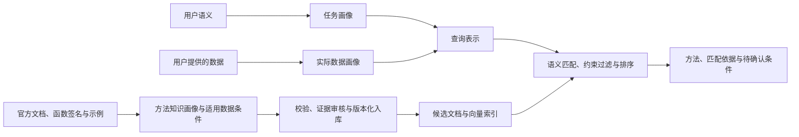

# 被检索知识库的画像建设责任

2026-10-25：根据用户补充，系统负责查询端和候选库端两条画像工作流。被检索的数据库按工作手册定义为 R 函数与统计方法知识库；我们负责其来源收集、画像生成、校验、入库、索引和持续更新，不能将其视为由外部提供的现成库。

## 两端如何匹配

用户数据画像描述实际观测，如样本数、变量类型、缺失率和矩阵秩。候选方法画像描述该方法要求或支持的数据条件，如输入类型、变量角色、样本量与维数关系、分组结构、缺失值处理能力和失败条件。方法本身没有用户数据的均值、方差等观测统计量，二者通过可比较的字段和明确的适用规则关联。

每条候选画像还需保存任务语义、函数签名、关键参数、预期输出、替代方法、官方来源、包版本、证据位置与核验状态。模型假设、实际观测、执行限制和项目偏好必须分别表达。缺乏证据的条件标为未知，不能自动转成硬约束。

例如：任务要求 PCA，用户数据为 20 个样本、100 个数值特征；候选库记录 princomp 原始矩阵接口的 n≥p 条件，因此该接口被排除。prcomp 可以保留为候选，但仍需检查缺失、常数列和缩放要求。规则应能追溯到画像中的依据。

## 当前状态与缺口

| 环节 | 当前实现 | 尚待建设 |
|---|---|---|
| 来源与画像 | 九条带来源的 JSON 知识画像；单篇官方文档 LLM 草稿验证 | 版本化来源清单、文档快照、批量提取与失败恢复 |
| 质量控制 | Schema/重复 ID 检查；草稿未核验并隔离 | 字段证据检查、冲突处理、复核记录和明确入库流程 |
| 数据适用条件 | 画像含条件文本；检索代码实现部分约束 | 条件与画像证据逐条关联、结构化条件及确定性规则解释 |
| 存储与索引 | 随包 JSON；运行时文档编码缓存 | 持久化候选画像库、版本快照、增量向量索引和更新失效处理 |
| 评估 | 开发者编写的小样本检索诊断 | 独立知识画像参考、字段质量与约束正确性评估 |

当前 SQLite 保存分析运行记录，并非候选知识库。当前运行时向量缓存也不等于已建成持久化向量数据库。

## 下一阶段交付顺序

1. 基于现有九条方法建立来源清单和候选画像管理入口，明确文档、函数和包版本标识。
2. 打通文档解析、批量画像草稿、字段证据校验、复核记录与版本化入库；未核验草稿不自动成为可信检索条目。
3. 将已有约束与画像证据关联，建立受限的结构化条件表示。禁止直接执行文档或 LLM 输出的表达式；事实不足时返回未知。
4. 建立候选画像持久化存储与向量索引；画像、编码模型或文本版本变化时更新索引，记录每次检索使用的库版本。
5. 用独立参考检查画像正确性、来源覆盖、更新一致性及适用条件判定，再逐步扩大知识覆盖范围。

以上为新增明确的建设计划，尚未实现的环节不计入 v0.2.0 完成项。批量建库应先在现有方法范围内验收，再扩大文档来源与方法数量。
